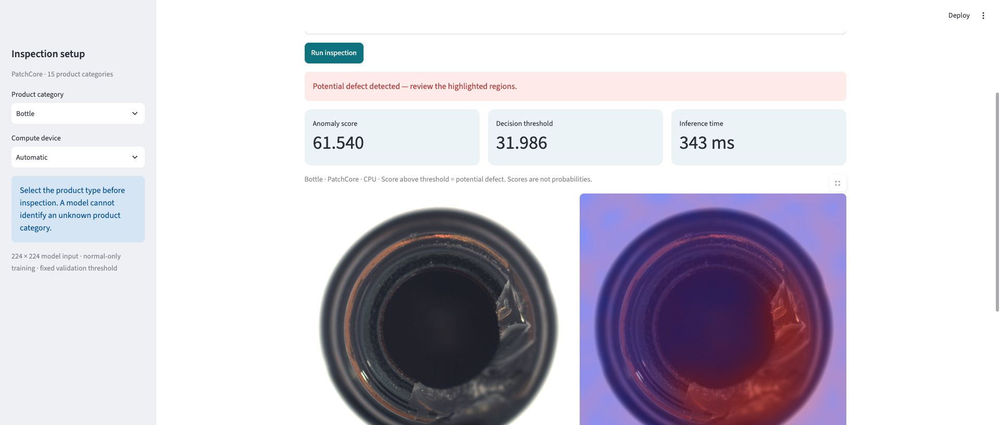

# InspectIQ

## Project Title

InspectIQ: AI Visual Defect Detection Using Deep Learning and Ensemble Anomaly Scoring

**Group 30 — NUS-ISS Pattern Recognition Systems Practice Module**

## Executive Summary / Paper Abstract

InspectIQ investigates normal-only visual defect detection for industrial inspection. The project compares six methods across all 15 categories of the MVTec AD dataset: a convolutional autoencoder, a frozen CNN feature baseline, an AE + CNN ensemble, PatchCore, a DINOv2-based anomaly detector, and an AE + DINO ensemble. All methods use the same category splits and a fixed 224 × 224 evaluation protocol. Decision thresholds are calibrated using normal validation images.

PatchCore achieved the strongest result in this comparison, with a macro image AUROC of 0.9840 and macro F1 of 0.9514. Equal-weight score fusion did not improve AUROC over the stronger feature-based component. These findings motivated the selection of PatchCore for the final inspection application. AUROC measures ranking quality, not classification accuracy; these adapted, single-seed experiments are not an exact reproduction of published SOTA results.

The final application combines a Streamlit interface with a local inference backend. Users select a product category, inspect an uploaded image, review an anomaly score and heatmap, and export the inspection result. Packaged models support CPU or NVIDIA CUDA inference and work offline after downloading. The project demonstrates an evaluated academic prototype; benchmark performance does not establish production reliability under new cameras, lighting or product conditions.

## Credits / Project Contribution

| Official Full Name | Student ID (MTech Applicable) | Work Items (Who Did What) |
| --- | --- | --- |
| Yeom Dongjun | A0354802H | Led the overall implementation and system integration, coordinated GPU experiment execution and the six-method comparison across all 15 MVTec AD categories, and developed the Streamlit inspection interface. Integrated the selected PatchCore model into the application and coordinated end-to-end demonstration testing. |
| Nguyen Tri Nghia | A0355672W | Managed model packaging and deployment preparation, verified model loading and inference behaviour, and maintained execution instructions and release documentation. Conducted false-positive and false-negative analysis, reviewed anomaly heatmaps, and assessed technical limitations and improvement opportunities. |
| Zaiyu Zhang | A0357851U | Reviewed related research and anomaly detection techniques, contributed to experimental design and the evaluation protocol, and analysed model and ensemble performance. Supported the interpretation of evaluation metrics and the rationale for selecting the final model. |
| Worameth Wittanakorn | A0356365W | Researched and documented the MVTec AD dataset, contributed to data preparation and split validation, and reviewed category coverage and normal/defective image characteristics. Organised representative examples and checked the consistency of dataset descriptions and visual materials. |

**Shared contribution:** All four members participated in researching datasets and reference materials, reviewing code and experimental findings, and discussing implementation decisions. The allocation identifies primary responsibilities rather than exclusive ownership.

## System Documentation and User Guide

InspectIQ connects normal-only model evaluation with a runnable product inspection workflow. Its interface and inference backend run together in one local Streamlit application; a separate API server is not required.

See the [architecture](docs/ARCHITECTURE.md), [dataset description](docs/DATASET.md), [evaluation protocol](docs/EVALUATION.md), and [experiment reproduction guide](docs/REPRODUCIBILITY.md) for technical details.

## Key capabilities

- **Category-specific inspection.** Select one of 15 product categories and apply its saved normal-feature memory bank and threshold.
- **Visual defect review.** Compare the original image with an anomaly heatmap and review the score, verdict and inference time.
- **Exportable results.** Download the inspection report as JSON and the overlay as a PNG.
- **Offline inference.** Use checksum-verified released models on CPU or NVIDIA CUDA after the initial download.
- **Reproducible comparisons.** Run six methods with shared splits, validation-based calibration, saved artifacts and verified stage-level resume.

## Current implementation and limits

Our proposal, **Visual Defect Detection Using Deep Learning and Ensemble Anomaly Scoring**, investigated normal-only industrial inspection using reconstruction and pretrained visual features. We implemented an autoencoder, a frozen CNN baseline, and score ensembles, then extended the comparison to PatchCore and a DINOv2-based anomaly detector.

After evaluating six methods across all **15 MVTec AD categories**, we selected **PatchCore** for the final demo. It extracts patch features using a pretrained Wide ResNet-50-2, compares them with a coreset of normal training features, and produces image-level anomaly scores and spatial anomaly maps. Each category has its own memory bank and validation-calibrated threshold. No defect labels are used for training or threshold selection.

The frontend and inference backend are delivered together in one Streamlit application. A separate web/API server is not required.

The implementation uses established research methods. Our project contribution is their comparative evaluation, failure analysis, model packaging and integration into an inspection application. We do not claim to have invented PatchCore or DINOv2.

## Run

### Prerequisites and installation

Use **Python 3.12** and run these commands in a terminal:

```bash
git clone https://github.com/AndyYeom/Visual_Defect_Detection.git
cd Visual_Defect_Detection
python3.12 -m venv .venv
source .venv/bin/activate
python -m pip install --upgrade pip
python -m pip install -e '.[demo]'
python scripts/download_models.py
python -m streamlit run app/streamlit_app.py
```

On Windows, create the environment with `py -3.12 -m venv .venv` and activate it using `.venv\Scripts\Activate.ps1` in PowerShell. The remaining `python` commands are the same.

Open **http://localhost:8501**. The model download is a one-time step; the app then works offline. No Colab, Google Drive login, full dataset, or retraining is needed for uploaded-image inference. Allow several GB of free disk space for Python packages and models. CPU is supported, including Mac; the app does not use Apple MPS.

If the automatic model download is blocked, download `patchcore-models-v1.zip` from [Releases](https://github.com/AndyYeom/Visual_Defect_Detection/releases), then run:

```bash
python scripts/download_models.py --archive /path/to/patchcore-models-v1.zip
```

The installer verifies the release checksum and model checksums. Do not rename or mix model files from different runs.

### NVIDIA GPU

Install a CUDA-enabled PyTorch/torchvision pair suitable for your system using the [official PyTorch installer](https://pytorch.org/get-started/locally/) before installing this project. Select **Automatic** or **NVIDIA GPU** in the app. Automatic uses CUDA when available, otherwise CPU. A GPU improves speed but is not required for the demo.

### Troubleshooting project imports

If the app reports `No module named 'vdd'`, stop the server, activate the intended environment, and reinstall the project from the repository root with `python -m pip install -e '.[demo]'`. Then launch it with the same `python` executable. If the local environment still omits the editable source path, use this explicit path for the current terminal session:

```bash
# macOS / Linux, from the repository root
PYTHONPATH="$PWD/src" python -m streamlit run app/streamlit_app.py
```

```powershell
# Windows PowerShell, from the repository root
$env:PYTHONPATH = Join-Path (Get-Location) 'src'
python -m streamlit run app/streamlit_app.py
```

## First-use workflow

1. Select a **Product category**, for example Bottle.
2. Upload a PNG or JPEG of that product (up to 20 MB / 25 million pixels).
3. Click **Run inspection**. The first inspection includes model loading; subsequent inspections reuse the loaded model.
4. Review the verdict, anomaly score, decision threshold, inference time, original image, and heatmap overlay.
5. Download the inspection JSON and overlay PNG for your presentation.

The score is **not a probability**. Red indicates relatively unusual regions within that image; heatmap colors are normalized for display and are not a calibrated segmentation mask. The category must match the uploaded object. A bottle model cannot reliably inspect an unrelated object or an arbitrary photograph.

If MVTec AD is already installed locally, enable the optional example selector:

```bash
VDD_DATA_ROOT=/path/to/mvtec_anomaly_detection python -m streamlit run app/streamlit_app.py
```

The data directory should contain `bottle/train/good`, `bottle/test`, etc. Example images stay on your machine and are not bundled in this repository. For a short presentation, demonstrate one normal and one defective image from the same category, explain the score/threshold, then show the method comparison below.




### Presentation examples: normal first, defective second

With the local example selector enabled, select **Bottle**, then:

1. Choose `test/good/000.png`, click **Use this example**, then **Run inspection**. The recorded score is approximately **27.82**, below the fixed threshold of **31.99**.
2. Choose `test/broken_large/000.png`, click **Use this example** again, then **Run inspection**. The recorded score is approximately **61.54**, above the same threshold.
3. Compare the original image with the heatmap and show the JSON/PNG download controls.

These scores belong to those specific images and the released model. Other images have different scores, and minor device differences are possible. Load the model once before presenting to avoid including first-load overhead in the demonstration.

## Experimental results

Results are **macro averages across 15 categories**, from the completed `full15_224_v1` experiment:

| Method | Image AUROC | F1 |
|---|---:|---:|
| Autoencoder | 0.5781 | 0.2715 |
| Frozen CNN baseline | 0.8588 | 0.7027 |
| AE + CNN ensemble | 0.8197 | 0.6818 |
| **PatchCore — selected** | **0.9840** | **0.9514** |
| DINOv2-based anomaly detector | 0.9679 | 0.9258 |
| AE + DINO ensemble | 0.9464 | 0.9091 |

PatchCore pixel AUROC: **0.9763**; pixel average precision: **0.5423**. Category-average image precision: **0.9510**, recall: **0.9567**, false-positive rate: **0.1522**. AUROC 0.9840 is a ranking metric, **not 98.4% classification accuracy**.

Protocol: 224 × 224 inputs; normal training images split 80/20 for training/validation with seed 42; thresholds fixed at the normal validation 95th percentile; official test split used only for evaluation. PatchCore uses layers 2 and 3 of Wide ResNet-50-2, 1% coreset sampling, and 9 neighbors. Baseline autoencoder training used 10 epochs and batch size 16. Ensembles use fixed 50/50 scores after normal-validation calibration. See [evaluation details](docs/EVALUATION.md) and the exported experiment summary in the model package.

These are our adapted experimental implementations, not claims to reproduce published SOTA numbers. The DINO baseline uses DINOv2 ViT-S/14 without foreground masking or rotation augmentation. False positives remain substantial in some categories; deployment on new cameras, lighting, or products requires representative validation and human review. Test labels must not be used to tune the demo threshold.


### Why PatchCore?

PatchCore achieved the highest macro image AUROC and F1 in our comparison. Fixed fusion did not improve the stronger component: AE + CNN scored 0.8197 AUROC versus CNN's 0.8588; AE + DINO scored 0.9464 versus DINO's 0.9679. These findings support the selected model for this experiment, not a universal claim about ensembles.

The selected model still produced 59 false alarms and 73 missed defects across the pooled test set. Capsule, pill and screw accounted for 65 of those misses. These pooled counts complement the category-averaged metrics above. The demo therefore supports inspection and human review, rather than guaranteeing defect-free production.

## Final deliverables

- [Final report (Word)](submission/InspectIQ-Final-Report.docx)
- [Submission presentation (PowerPoint, no speaker notes)](submission/InspectIQ-Final-Presentation.pptx)
- [Measured results and evaluation protocol](docs/EVALUATION.md)
- [Runnable demo models](https://github.com/AndyYeom/Visual_Defect_Detection/releases)
- [Full experiment reproduction instructions](docs/REPRODUCIBILITY.md)

The live demonstration is launched with the quick start below. A recorded demo video is not included in this repository.

## Repository contents

- `app/streamlit_app.py`: interactive inspection UI.
- `src/vdd/patchcore_inference.py`: checksum-verified offline model loading and inference.
- `src/vdd/benchmark.py`: PatchCore/DINO feature experiments.
- `src/vdd/pipeline.py`: autoencoder, CNN, and ensemble baseline pipeline.
- `src/vdd/suite.py`: resumable category experiment runner.
- `notebooks/`: Colab workflows and analysis scripts.
- `scripts/download_models.py`: install the versioned release models.
- `scripts/export_patchcore.py`: package already evaluated models with a shared backbone.
- `tests/`: data/protocol, GPU selection, suite, and deployment checks.
- `artifacts/patchcore/`: downloaded models and evaluation exports (excluded from Git).

Large weights are distributed as a release asset rather than committed to Git. MVTec AD is not redistributed. Obtain the dataset from its official provider and follow its license. The release package includes pretrained backbone weights and category memory banks; this is an academic research demo, not a certified industrial inspection system.

## Verify and reproduce

```bash
python -m pip install -e '.[demo,dev]'
python -m ruff check .
python -m pytest
python -m vdd.cli --help
python -m vdd.benchmark --help
python -m vdd.suite --help
```

For exact fresh-run, resume, Colab and export commands, see [Reproducing the experiments](docs/REPRODUCIBILITY.md). No previous team experiment is required.

Training requires downloading pretrained feature extractors on first use. The released demo models do not. Existing run directories are retained for traceability; do not combine incompatible experiment protocols when resuming.

## References and attribution

- Roth et al., *Towards Total Recall in Industrial Anomaly Detection*, CVPR 2022 — [PatchCore paper and authors' implementation](https://github.com/amazon-science/patchcore-inspection).
- Bergmann et al., *MVTec AD — A Comprehensive Real-World Dataset for Unsupervised Anomaly Detection*, CVPR 2019 — [official dataset](https://www.mvtec.com/company/research/datasets/mvtec-ad).
- [Anomalib](https://github.com/open-edge-platform/anomalib): PatchCore model implementation used in this project (version 2.7.0).
- Damm et al., *AnomalyDINO: Boosting Patch-Based Few-Shot Anomaly Detection with DINOv2*, WACV 2025 — [paper](https://arxiv.org/abs/2405.14529). Our DINO comparison uses the available normal training split rather than the paper's few-shot protocol and omits foreground masking and rotation augmentation.
- [DINOv2](https://github.com/facebookresearch/dinov2): pretrained visual representation used for the DINO comparison.
- [PyTorch](https://pytorch.org/) and [Streamlit](https://streamlit.io/): model inference and interactive application.
