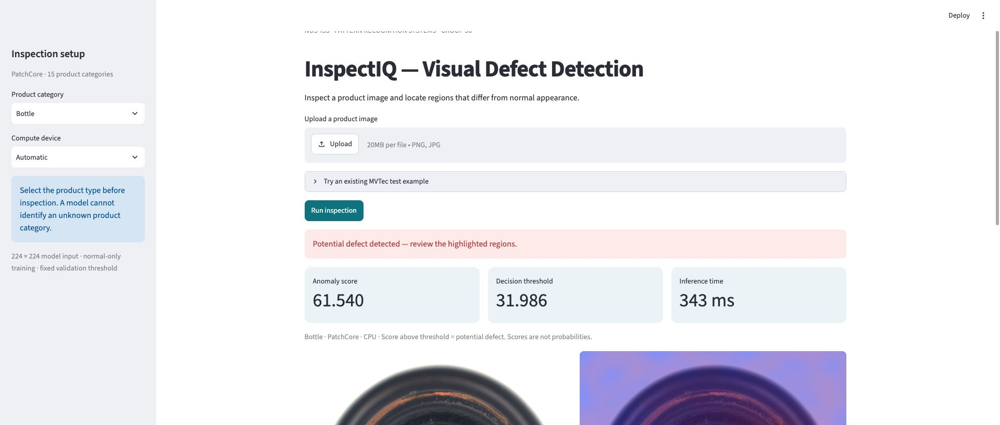
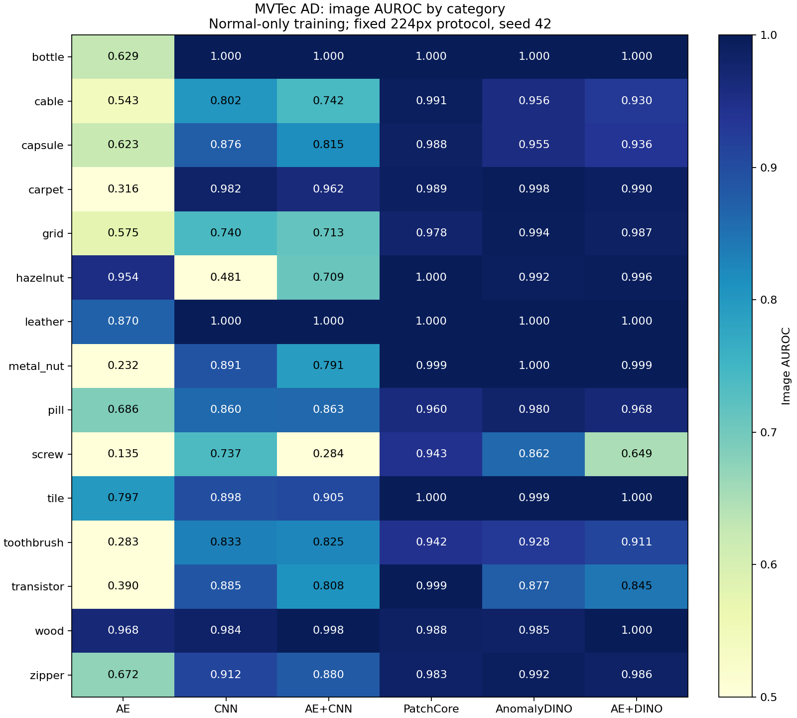

# InspectIQ — Visual Defect Detection

**NUS-ISS · Pattern Recognition Systems Practice Module · Group 30**

A runnable visual inspection application that detects unusual product appearance and highlights suspected defect regions. Upload an image, choose its product category, and inspect the **PatchCore** anomaly score, normal/abnormal decision, and heatmap. The application runs locally on CPU or NVIDIA CUDA GPU.

## Team

| Name | Student ID |
|---|---|
| Yeom Dongjun | A0354802H |
| Zaiyu Zhang | A0357851U |
| Worameth Wittanakorn | A0356365W |
| Nguyen Tri Nghia | A0355672W |

## Project and final approach

Our proposal, **Visual Defect Detection Using Deep Learning and Ensemble Anomaly Scoring**, investigated normal-only industrial inspection using reconstruction and pretrained visual features. We implemented an autoencoder, a frozen CNN baseline, and score ensembles, then extended the comparison to PatchCore and a DINOv2-based anomaly detector.

After evaluating six methods across all **15 MVTec AD categories**, we selected **PatchCore** for the final demo. It extracts patch features using a pretrained Wide ResNet-50-2, compares them with a coreset of normal training features, and produces image-level anomaly scores and spatial anomaly maps. Each category has its own memory bank and validation-calibrated threshold. No defect labels are used for training or threshold selection.

The frontend and inference backend are delivered together in one Streamlit application. A separate web/API server is not required.

## Quick start

Use **Python 3.12** and run these commands in a terminal:

```bash
git clone https://github.com/AndyYeom/Visual_Defect_Detection.git
cd Visual_Defect_Detection
python3.12 -m venv .venv
source .venv/bin/activate
python -m pip install --upgrade pip
python -m pip install -e '.[demo]'
python scripts/download_models.py
python -m streamlit run app/streamlit_app.py
```

On Windows, create the environment with `py -3.12 -m venv .venv` and activate it using `.venv\Scripts\Activate.ps1` in PowerShell. The remaining `python` commands are the same.

Open **http://localhost:8501**. The model download is a one-time step; the app then works offline. No Colab, Google Drive login, full dataset, or retraining is needed for uploaded-image inference. Allow several GB of free disk space for Python packages and models. CPU is supported, including Mac; the app does not use Apple MPS.

If the automatic model download is blocked, download `patchcore-models-v1.zip` from [Releases](https://github.com/AndyYeom/Visual_Defect_Detection/releases), then run:

```bash
python scripts/download_models.py --archive /path/to/patchcore-models-v1.zip
```

The installer verifies the release checksum and model checksums. Do not rename or mix model files from different runs.

### NVIDIA GPU

Install a CUDA-enabled PyTorch/torchvision pair suitable for your system using the [official PyTorch installer](https://pytorch.org/get-started/locally/) before installing this project. Select **Automatic** or **NVIDIA GPU** in the app. Automatic uses CUDA when available, otherwise CPU. A GPU improves speed but is not required for the demo.

## Demonstration workflow

1. Select a **Product category**, for example Bottle.
2. Upload a PNG or JPEG of that product (up to 20 MB / 25 million pixels).
3. Click **Run inspection**. The first inspection includes model loading; subsequent inspections reuse the loaded model.
4. Review the verdict, anomaly score, decision threshold, inference time, original image, and heatmap overlay.
5. Download the inspection JSON and overlay PNG for your presentation.

The score is **not a probability**. Red indicates relatively unusual regions within that image; heatmap colors are normalized for display and are not a calibrated segmentation mask. The category must match the uploaded object. A bottle model cannot reliably inspect an unrelated object or an arbitrary photograph.

If MVTec AD is already installed locally, enable the optional example selector:

```bash
VDD_DATA_ROOT=/path/to/mvtec_anomaly_detection python -m streamlit run app/streamlit_app.py
```

The data directory should contain `bottle/train/good`, `bottle/test`, etc. Example images stay on your machine and are not bundled in this repository. For a short presentation, demonstrate one normal and one defective image from the same category, explain the score/threshold, then show the method comparison below.



## Experimental results

Results are **macro averages across 15 categories**, from the completed `full15_224_v1` experiment:

| Method | Image AUROC | F1 |
|---|---:|---:|
| Autoencoder | 0.5781 | 0.2715 |
| Frozen CNN baseline | 0.8588 | 0.7027 |
| AE + CNN ensemble | 0.8197 | 0.6818 |
| **PatchCore — selected** | **0.9840** | **0.9514** |
| DINOv2-based anomaly detector | 0.9679 | 0.9258 |
| AE + DINO ensemble | 0.9464 | 0.9091 |

PatchCore pixel AUROC: **0.9763**; pixel average precision: **0.5423**. Category-average image precision: **0.9510**, recall: **0.9567**, false-positive rate: **0.1522**. AUROC 0.9840 is a ranking metric, **not 98.4% classification accuracy**.

Protocol: 224 × 224 inputs; normal training images split 80/20 for training/validation with seed 42; thresholds fixed at the normal validation 95th percentile; official test split used only for evaluation. PatchCore uses layers 2 and 3 of Wide ResNet-50-2, 1% coreset sampling, and 9 neighbors. Baseline autoencoder training used 10 epochs and batch size 16. Ensembles use fixed 50/50 scores after normal-validation calibration. See [evaluation details](docs/EVALUATION.md) and the exported experiment summary in the model package.

These are our adapted experimental implementations, not claims to reproduce published SOTA numbers. The DINO baseline uses DINOv2 ViT-S/14 without foreground masking or rotation augmentation. False positives remain substantial in some categories; deployment on new cameras, lighting, or products requires representative validation and human review. Test labels must not be used to tune the demo threshold.



## Repository contents

- `app/streamlit_app.py`: interactive inspection UI.
- `src/vdd/patchcore_inference.py`: checksum-verified offline model loading and inference.
- `src/vdd/benchmark.py`: PatchCore/DINO feature experiments.
- `src/vdd/pipeline.py`: autoencoder, CNN, and ensemble baseline pipeline.
- `src/vdd/suite.py`: resumable category experiment runner.
- `notebooks/`: Colab workflows and analysis scripts.
- `scripts/download_models.py`: install the versioned release models.
- `scripts/export_patchcore.py`: package already evaluated models with a shared backbone.
- `tests/`: data/protocol, GPU selection, suite, and deployment checks.
- `artifacts/patchcore/`: downloaded models and evaluation exports (excluded from Git).

Large weights are distributed as a release asset rather than committed to Git. MVTec AD is not redistributed. Obtain the dataset from its official provider and follow its license. The release package includes pretrained backbone weights and category memory banks; this is an academic research demo, not a certified industrial inspection system.

## Development and reproduction

```bash
python -m pip install -e '.[demo,dev]'
python -m pytest
python -m vdd.cli --help
python -m vdd.benchmark --help
python -m vdd.suite --help
```

Training requires downloading pretrained feature extractors on first use. The released demo models do not. Existing run directories are retained for traceability; do not combine incompatible experiment protocols when resuming.

## References and attribution

- Roth et al., *Towards Total Recall in Industrial Anomaly Detection*, CVPR 2022 — [PatchCore paper and authors' implementation](https://github.com/amazon-science/patchcore-inspection).
- Bergmann et al., *MVTec AD — A Comprehensive Real-World Dataset for Unsupervised Anomaly Detection*, CVPR 2019 — [official dataset](https://www.mvtec.com/company/research/datasets/mvtec-ad).
- [Anomalib](https://github.com/open-edge-platform/anomalib): PatchCore model implementation used in this project (version 2.7.0).
- [DINOv2](https://github.com/facebookresearch/dinov2): pretrained visual representation used for the DINO comparison.
- [PyTorch](https://pytorch.org/) and [Streamlit](https://streamlit.io/): model inference and interactive application.
