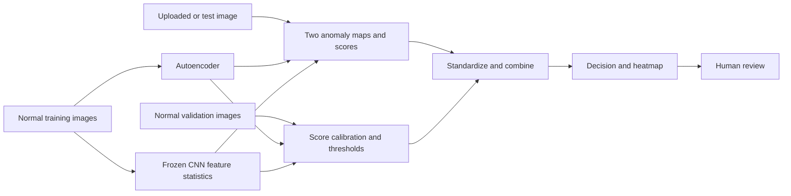

# Visual Defect Detection

**Visual Defect Detection Using Deep Learning and Ensemble Anomaly Scoring**

NUS-ISS Pattern Recognition Systems Practice Module · Group 30

Research prototype that learns normal product appearance, flags unusual images, and highlights suspected defect regions for human review. It compares a convolutional autoencoder, a pretrained CNN feature-distance baseline, and a weighted ensemble.

**Status: initial implementation, not a trained or validated inspection system.** The proposal leaves the dataset open. This scaffold supports MVTec AD-style folders and suggests MVTec AD as a first candidate, subject to the team's dataset review. No real-data results or trained weights are included.

[한국어 시작 안내](docs/QUICKSTART_KO.md) · [Dataset plan](docs/DATASET.md) · [Evaluation protocol](docs/EVALUATION.md) · [Project plan](docs/PROJECT_PLAN.md)

## Scope

| Requirement | Implementation |
| --- | --- |
| Unsupervised learning | Fit normal training images only; normal validation calibrates scores |
| Deep learning | Small convolutional autoencoder, reconstruction-error map |
| Pretrained CNN | Frozen ImageNet ResNet18 through layer2, per-location diagonal feature distance |
| Ensemble | Validation-standardized scores, fixed 50/50 weighted average |
| Evaluation | AUROC, precision, recall, F1, false-positive rate, mean/p95 CPU latency |
| Demo | Image upload, normal/anomalous result, score, relative heatmap, local review log |

This CNN baseline is deliberately simple and is **not** a reproduction of PatchCore or PaDiM. The heatmap supports inspection; pixel-level segmentation quality remains future work.



## Installation

Use Python 3.11 or 3.12. The initial implementation runs on CPU, including on macOS, without a CUDA setup.

```bash
git clone https://github.com/AndyYeom/Visual_Defect_Detection.git
cd Visual_Defect_Detection
python3 -m venv .venv
source .venv/bin/activate
python -m pip install --upgrade pip
python -m pip install -e '.[dev,demo]'
```

On Windows activate with `.venv\Scripts\activate`. The first real training run downloads official ImageNet ResNet18 weights through torchvision; inference uses weights stored in the checkpoint and needs no download. Dependency bounds are compatibility ranges, not an exact lock. Save `python -m pip freeze > artifacts/environment.txt` with each experiment.

## Quick pipeline check without a dataset download

```bash
python scripts/make_synthetic_data.py
vdd prepare --root data/synthetic --category synthetic --output artifacts/smoke-split.json
vdd train --root data/synthetic --manifest artifacts/smoke-split.json --output artifacts/smoke --epochs 1 --size 32 --offline-smoke
vdd evaluate --root data/synthetic --manifest artifacts/smoke-split.json --checkpoint artifacts/smoke/model.pt --output reports/smoke
vdd predict --checkpoint artifacts/smoke/model.pt --image data/synthetic/synthetic/test/scratch/000.png --output reports/smoke-prediction
```

`--offline-smoke` uses **random CNN weights** exclusively for integration testing. Synthetic metrics are not evidence of defect-detection performance. The demo visibly warns when this model is loaded.

## Real-data workflow

Download an approved dataset from its original source and arrange one category as shown in [DATASET.md](docs/DATASET.md). This example uses the candidate category `bottle`; choosing it is not a final project decision.

```bash
vdd prepare --root data/mvtec_ad --category bottle --output artifacts/bottle-split.json
vdd train --root data/mvtec_ad --manifest artifacts/bottle-split.json --output artifacts/bottle --epochs 10 --size 128
vdd evaluate --root data/mvtec_ad --manifest artifacts/bottle-split.json --checkpoint artifacts/bottle/model.pt --output reports/bottle
vdd predict --checkpoint artifacts/bottle/model.pt --image path/to/bottle.png --output reports/example
python -m streamlit run app/streamlit_app.py
```

Enter `artifacts/bottle/model.pt` in the demo sidebar. A model applies to **one product category**. Train separate checkpoints for additional categories. The demo logs human reviews to `artifacts/demo/reviews.jsonl`; it does not retrain or change thresholds automatically.

### Outputs

- `split.json`: relative paths, labels, seed, split assignments, SHA-256 image hashes.
- `model.pt` and `training.json`: both models, fitted feature statistics, validation calibration, thresholds and training metadata.
- `metrics.json` and `predictions.csv`: comparison of all three methods and per-image scores.
- `overlay.png` and `prediction.json`: local prediction and relative heatmap.

Image scores are the mean of the highest 1% of anomaly-map values. Validation means and standard deviations put both scores on comparable scales. The default threshold is the 95th percentile of normal validation scores for each method. This does not guarantee a 5% false-positive rate on unseen data, especially with small validation sets. Scores can be negative and are not probabilities.

## Repository layout

```text
app/                    Streamlit local demonstration
src/vdd/                Data, models, scoring, training, inference, CLI
scripts/                Synthetic smoke-test dataset generator
tests/                  Split integrity, calibration, end-to-end tests
configs/                Baseline settings reference
docs/                   Dataset, evaluation, architecture, project and report plans
.github/                CI, issue and PR templates
data/                   Local datasets (ignored)
artifacts/              Local manifests, checkpoints, logs (ignored)
reports/                Local evaluation output (ignored)
```

## Checks

```bash
ruff check .
pytest -q
```

CI runs an offline synthetic end-to-end test, so it does not need dataset access or pretrained weight downloads. Real pretrained-model training and benchmark quality must be evaluated separately. Tests reject duplicate images across splits, altered files, non-normal training/validation labels, and mismatched evaluation manifests.

## Limitations and next steps

1. Agree on the dataset, permitted use and product categories; review the split manifest.
2. Establish real-data baselines before changing architectures or hyperparameters.
3. Inspect missed defects and false alarms. Record conditions under which the ensemble underperforms.
4. Add pixel-level mask evaluation, multi-seed experiments and controlled robustness tests if time allows.
5. Finish the report, slides and demo video using measured results.

The CNN distance assumes spatial alignment and independent feature channels. Reconstruction error can miss well-reconstructed anomalies. The 128×128 default may erase small defects. Heatmaps are per-image visual explanations, not calibrated segmentation or defect-type labels. This local demo has no multi-user persistence or production authentication.

## Team and provenance

Yeom Dongjun, Zaiyu Zhang, Worameth Wittanakorn, Nguyen Tri Nghia. Source scope: Group 30 proposal and presentation dated 30 September 2026. Planned completion in those materials: **31 October 2026**. Student IDs and original Office documents are intentionally excluded.

The implementation choices (ResNet18, diagonal statistics, score pooling, split fraction, default thresholds and Streamlit) are draft engineering decisions, not claims that the original proposal specified them. See [PROJECT_PLAN.md](docs/PROJECT_PLAN.md).

## References and usage

- [MVTec AD official dataset](https://www.mvtec.com/research-teaching/datasets/mvtec-ad)
- [MVTec AD paper, CVPR 2019](https://openaccess.thecvf.com/content_CVPR_2019/html/Bergmann_MVTec_AD_--_A_Comprehensive_Real-World_Dataset_for_Unsupervised_Anomaly_CVPR_2019_paper.html)
- [Torchvision ResNet18 documentation](https://docs.pytorch.org/vision/stable/models/generated/torchvision.models.resnet18.html)

Dataset and pretrained-weight terms remain with their respective providers. No software licence has been selected for this team draft; agree on licensing before external redistribution. Do not commit raw datasets, trained weights, credentials or identifying student records.
